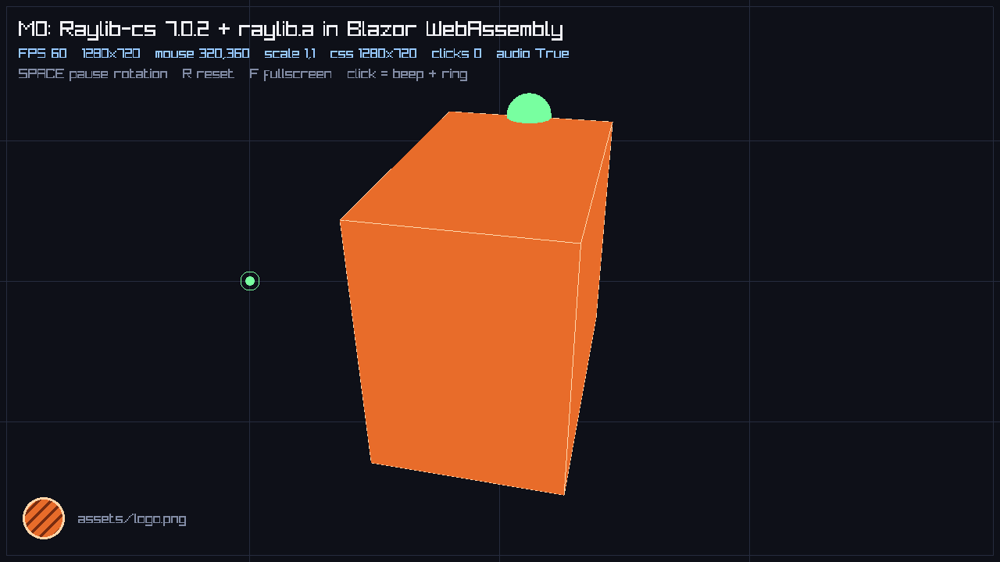

# Spike 0001 - Raylib-cs + raylib.a inside a fresh Blazor WebAssembly app

- **Date:** 2026-10-21
- **Time spent:** ~2 h
- **Milestone:** M0 (decision gate)
- **Verdict:** **GO** on the decided baseline (Raylib-cs 7.0.2 + vendored `raylib.a`), with four plan corrections.
- **Spike code:** [`spike/m0-raylib-blazor/`](../../spike/m0-raylib-blazor) - throwaway, not part of the future solution.

## 1. Question

The plan originally proposed Raylib-cs 8.1.0 (official `browser-wasm` package). The review decided to **stay
on the proven Raylib-cs 7.0.2 + vendored Emscripten `raylib.a`** and upgrade later. So the question changed to:

> Does that combination work in a *fresh* Blazor WebAssembly project that follows the Rayforge design
> (host-owned window, JS-bound canvas, one synchronous `[JSExport]` per `requestAnimationFrame`, assets in the
> Emscripten VFS), without depending on anything from `Wolfrender.Blazor.Raylib`?

Secondary questions:

1. Does `WasmFilesToIncludeInFileSystem` work under `Microsoft.NET.Sdk.BlazorWebAssembly` (the source of the
   "Bundled" asset mode)?
2. Is the mouse mapping in Fit mode correct at non-1:1 CSS scales and at DPR 2?
3. Does `dotnet publish` + static hosting work with the .NET 10 toolchain on this machine?

## 2. Environment

| Component | Version |
|---|---|
| OS | Linux (Omarchy/Arch), x86_64 |
| .NET SDK | 10.0.402 (`mise`-managed, user-local) |
| wasm-tools | installed during the spike (`10.0.13` packs, Mono runtime pack + Emscripten 3.1.56) |
| Raylib-cs | 7.0.2 (NuGet cache) |
| `raylib.a` | 1,628,010 bytes, Emscripten build of **raylib 5.6-dev**, GLFW backend (copied from `Wolfrender.Blazor.Raylib`) |
| Browser | Chromium (headless, SwiftShader), driven by `puppeteer-core` |
| Blazor | `Microsoft.NET.Sdk.BlazorWebAssembly`, `net10.0`, `RuntimeIdentifier=browser-wasm`, `SelfContained=true` |

Commands:

```bash
dotnet workload install wasm-tools                       # was missing on this machine

# dev loop (Debug, no AOT, links at -O0)
dotnet run --project spike/m0-raylib-blazor

# publish + static serve
dotnet publish spike/m0-raylib-blazor -c Release -p:EmccLinkOptimizationFlag=-O0 -o artifacts/m0
python3 -m http.server --directory artifacts/m0/wwwroot 5099   # needs application/wasm mime
```

## 3. What works

All of the following was verified in a headless Chromium session with screenshots and console capture.

| Behavior | Result |
|---|---|
| Static link of `raylib.a` into the .NET WASM module | **Works.** `InitWindow` + `IsWindowReady() == true`. |
| Canvas binding via `Blazor.runtime.Module['canvas']` | **Works.** No `"canvas"` id assumptions; the module accepts any element. |
| `requestAnimationFrame` -> one synchronous `[JSExport]` per frame | **Works.** Steady 58-63 FPS in headless SwiftShader; no per-frame tasks or promises. |
| `[JSExport]` receives the C# component as `[JSMarshalAs<JSType.Any>] object` | **Works.** No handle table needed (still worth introducing one for clarity). |
| 3D rendering (`Camera3D`, `BeginMode3D`, cubes, depth) | **Works.** |
| 2D rendering (`DrawText`, `DrawLine`, `DrawCircleLinesV`, `DrawRectangleLines`) | **Works.** |
| Texture loading from the VFS (`LoadTexture("assets/logo.png")`) | **Works** - but only after the host wrote the file into MEMFS (see 4.1). |
| Audio (`InitAudioDevice`, `LoadSound`, `PlaySound`) | **Works.** `IsAudioDeviceReady() == true`, sound loaded (7200 frames for 0.15 s @44.1 kHz). |
| Fit-mode letterboxing at 900x900 and 700x900 viewports | **Works.** Canvas becomes 900x506 and 700x393, vertically centred. |
| Mouse mapping at CSS scale 1.0 / 1.422 / 1.829 | **Works** with `SetMouseScale(backingW/cssW, backingH/cssH)`. Marker landed exactly on the expected logical pixel in every case. |
| Mouse mapping at DPR 2 | **Correct** (CSS-based, so DPR does not move the pointer), but rendering is upscaled: the backing store stays 1280x720. Confirms HiDPI must be a separate mode. |
| Error overlay | **Works.** A failed JS import produced a readable Razor error panel instead of a black canvas. |
| `dotnet run` (Blazor DevServer) | **Works**, see 4.3. |
| `dotnet publish` + plain static server | **Works**, see 4.2 and 5. |
| Graceful behaviour when the browser tab is not focused | Not exercised. |

Visual proof: cube + text + texture + mouse marker + diagnostics all render, and the mouse marker sits under
the pointer at every tested scale.



## 4. Failures, workarounds and plan corrections

### 4.1 `WasmFilesToIncludeInFileSystem` is ignored by the Blazor SDK

The "Bundled" asset mode in the plan assumed the .NET WASM runtime pre-populates the VFS:

```xml
<WasmFilesToIncludeInFileSystem Include="Assets\**\*" TargetPath="assets\%(RecursiveDir)%(Filename)%(Extension)" />
```

Result in the browser:

```
[m0] File.Exists assets/logo.png = False
WARNING: FILEIO: [assets/logo.png] Failed to open file
[m0] logo 0x0 id=0
```

Nothing was in the published output and no manifest mentioned the files. The item is only consumed by the
plain WASM SDK's `WasmAppBuilder` (`WasmApp.Common.targets`, `BrowserWasmApp.targets`); the Blazor task assembly
(`Microsoft.NET.Sdk.BlazorWebAssembly.Tasks.dll`) does not reference it at all.

**Workaround used (and the recipe for the base):** fetch each asset in JS and write it into MEMFS before the
first frame:

```js
const data = new Uint8Array(await (await fetch(new URL(path, document.baseURI))).arrayBuffer());
FS.mkdir("assets");            // one mkdir per path segment
FS.writeFile("assets/logo.png", data);
```

**Plan corrections**

- Delete the "Bundled = runtime loads files into the VFS by itself" claim. On Blazor, **every** web asset is a
  fetch written into MEMFS. The difference between "Bundled" and "Preload" collapses to *where the list comes
  from* (build-time list vs manifest/groups) and whether progress is shown.
- Keep the names, redefine them: **Bundled** = host knows a build-generated list and loads everything before
  the first frame; **Preload** = manifest + groups + progress, loaded later.
- M1 must generate that list from MSBuild (e.g. a props file or a C# source-generated array), not from a
  hand-maintained array in `Program.cs`.

### 4.2 A `Content` item with `Link="wwwroot\..."` publishes fine but serves 0 bytes on the DevServer

Moving the shared `Assets/` folder into the web output the obvious way:

```xml
<Content Include="Assets\**\*" Link="wwwroot\assets\%(RecursiveDir)%(Filename)%(Extension)" />
```

- `dotnet publish`: correct, files land in `wwwroot/assets/`.
- `dotnet run`: `GET /assets/logo.png` -> **HTTP 200 with `Content-Length: 0`**.

Static web assets map the item to the physical path implied by its `Link` (`<project>/wwwroot/assets/...`),
which does not exist; the DevServer answers 200 with an empty body instead of a 404. `CopyToOutputDirectory`
on the item does not help.

**Workaround used (and the recipe for the base):** materialise the files under `wwwroot/assets/` *before* the
static web asset manifest is resolved, and register the real files instead of linked ones:

```xml
<ItemGroup>
  <GameAsset Include="Assets\**\*" />
</ItemGroup>

<Target Name="SyncGameAssetsIntoWwwroot" BeforeTargets="ResolveStaticWebAssetsInputs">
  <Copy SourceFiles="@(GameAsset)"
        DestinationFiles="@(GameAsset->'$(MSBuildProjectDirectory)\wwwroot\assets\%(RecursiveDir)%(Filename)%(Extension)')"
        SkipUnchangedFiles="true" />
  <ItemGroup>
    <Content Include="wwwroot\assets\**\*" Exclude="@(Content)" />
  </ItemGroup>
</Target>
```

Verified from a clean `rm -rf obj bin`: both `dotnet run` and `dotnet publish` serve the real bytes. The
generated `wwwroot/assets/` folder must be gitignored.

Do **not** keep both the `Content ... Link` item and this target: publish fails with
`Two assets found targeting the same path with incompatible asset kinds`.

Alternatives rejected for now: assets in a Razor Class Library (`_content/...`, extra project per game),
copying into the source tree manually (stale files), and serving assets from outside `wwwroot` (not supported).

### 4.3 Release native link fails: `wasm-opt: Unknown option '--enable-bulk-memory-opt'`

`dotnet publish -c Release` (which links with `-O2`) fails:

```
wasm-opt ... --mvp-features --enable-bulk-memory --enable-bulk-memory-opt ...
Unknown option '--enable-bulk-memory-opt'
emcc : error : '.../wasm-opt ...' failed (returned 1)
```

The Emscripten 3.1.56 pack ships **Binaryen 117**, which does not accept that flag. `-O0` does not invoke
`wasm-opt`, which is why Debug builds link fine.

**Workaround:** `-p:EmccLinkOptimizationFlag=-O0`. This works but gives up native-level optimisation; it is
acceptable for M0, not for a release (M5).

**Follow-ups:** try `dotnet workload update`, a different SDK band, or patching the rsp. Do not spend time on
it until M5 has a CI runner to compare against. Record the flag in the build docs so nobody rediscovers it.

### 4.4 `JSHost.ImportAsync` resolves relative URLs against `_framework/`

```csharp
await JSHost.ImportAsync("m0", "./js/m0.js");
// -> GET /_framework/js/m0.js  (404)
```

The module URL is resolved relative to the runtime's module base, not the document base. Build an absolute URL:

```csharp
var moduleUrl = new Uri(new Uri(NavigationManager.BaseUri), "js/m0.js").AbsoluteUri;
await JSHost.ImportAsync("m0", moduleUrl);
```

This also affects the planned `_content/Rayforge.Web/rayforge.js` path, and it is why a sub-path deployment
must use `NavigationManager.BaseUri` rather than a hardcoded `/_content/...`.

### 4.5 ABI drift between Raylib-cs 7.0.2 and the 5.6-dev `raylib.a`

The link emits three undefined symbols (allowed by `WasmAllowUndefinedSymbols`):

```
undefined symbol: DrawLineBezierCubic
undefined symbol: DrawLineBezierQuad
undefined symbol: GetSoundsPlaying
```

The bindings call entry points that do not exist in the vendored archive. Calling them at runtime will trap.
None are used by the demo, and none are common in games, but the porting guide must list them. If a port needs
them, rebuild `raylib.a` from the same raylib commit as the bindings (that is the real fix; the upgrade to
Raylib-cs 8.1.0 would also remove the mismatch).

### 4.6 Minor observations

- **Synthetic fast clicks are dropped.** A `mousedown`/`mouseup` dispatched in the same frame is invisible to
  `IsMouseButtonPressed`. A press held for >= 1 frame (a human click) works. Browser automation must hold the
  button; the porting guide should not treat `IsMouseButtonPressed` as reliable for sub-frame taps.
- **`GetFPS()` works** on web once real time is flowing (58-63). `EndDrawing` timing is still host-dependent;
  the diagnostics overlay should prefer the host-measured value.
- **One garbled frame** was captured immediately after the first `PlaySound`: text appeared as if the font
  atlas pointed at the framebuffer. It did not reproduce in 8 consecutive captures, and the default font
  otherwise renders correctly. Not explained; treat as "watch for it", not a blocker. Re-check in a real
  (non-SwiftShader) browser in M2.
- **`favicon.ico` 404** is the only console noise; add an icon or an empty file in the template.
- **Audio autoplay:** the harness launched Chromium with `--autoplay-policy=no-user-gesture-required`. The plan's
  click-to-start overlay is still required in real browsers; this spike did not prove otherwise.

## 5. Measurements (Release publish, `-O0` link, clean output)

| Metric | Value |
|---|---|
| Published `wwwroot` size (uncompressed) | 6.21 MB / 45 files |
| Brotli-prefetched size | 1.88 MB |
| Largest files | `dotnet.native.wasm` ~2.6 MB, `System.Private.CoreLib.wasm` ~1.4 MB |
| Local load to first frame | ~1.1 s (interpreter, no AOT, localhost) |
| Frame rate in headless Chromium | 58-63 FPS at 1280x720 |

Debug build links in a few seconds and is the right inner loop; Release adds wasm-opt (broken here, see 4.3).

## 6. Decision

**Proceed with Raylib-cs 7.0.2 + vendored `raylib.a`.** The technique is sound in a fresh project, and none of
the plan's core choices (host-owned window, `IGame` contract, rAF + synchronous `[JSExport]`, `SetMouseScale`
letterboxing, desktop parity) were invalidated.

Changes to `PLAN.md`:

1. **Assets:** the "Bundled VFS" mode does not exist on Blazor. Both modes are fetch->MEMFS; only the list and
   progress differ. M1 generates the asset list at build time.
2. **DevServer:** the asset copy target from 4.2 is part of the base (or template), and `wwwroot/assets/` is
   generated output.
3. **Release publish:** `EmccLinkOptimizationFlag=-O0` until 4.3 is solved in M5.
4. **JS module import:** always absolutise against `NavigationManager.BaseUri`.
5. Version matrix: Raylib-cs 7.0.2, raylib 5.6-dev, wasm-tools 10.0.13, Emscripten 3.1.56, Binaryen 117.

Not answered by this spike (moved to later milestones):

- Firefox/Safari behavior (only Chromium available on this machine) - M2.
- AOT size/time and stability - M5.
- Raylib-cs 8.1.0 upgrade - new milestone M7, after the base is stable.
- Pointer lock, `requestFullscreen`, text input - M3 (DoomFire does not need them either; revisit with Wolfrender).

## 7. Follow-ups

| # | Item | Owner milestone |
|---|---|---|
| 1 | Generate the web asset list from MSBuild instead of a hardcoded array | M1 |
| 2 | Move the asset-sync target into the framework's `buildTransitive` props | M1 |
| 3 | Solve the Release `wasm-opt` failure (workload update, SDK band, or patched rsp) | M5 |
| 4 | Cross-browser matrix: Chrome, Firefox, Safari; real gesture audio; font glitch | M2 |
| 5 | Decide whether the three missing raylib symbols matter; rebuild `raylib.a` if so | M1 |
| 6 | Re-evaluate Raylib-cs 8.1.0 (official `raylib.a`, raylib 6.0) once the base is stable | M7 |
