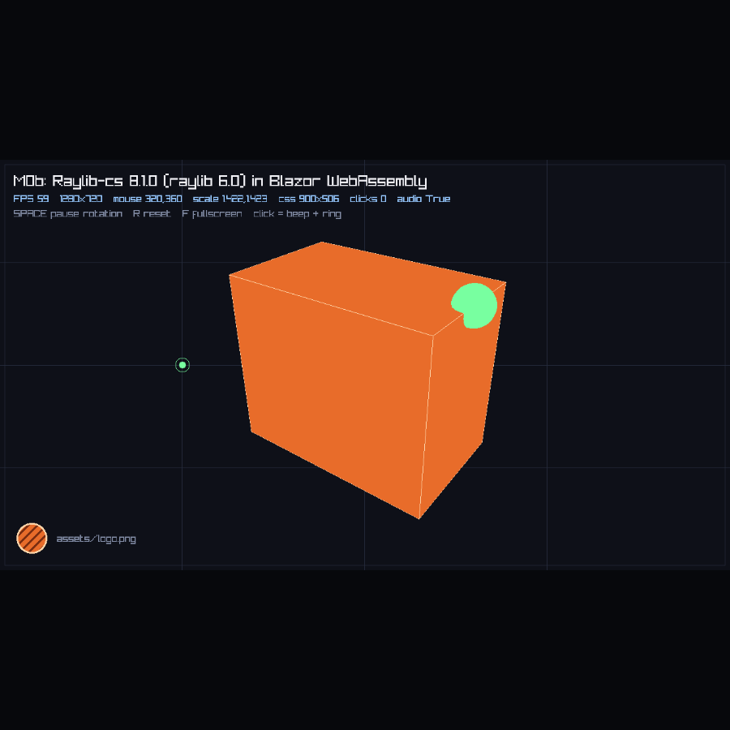

# Spike 0002 - Raylib-cs 8.1.0 with the official `browser-wasm` package

- **Date:** 2026-10-21
- **Time spent:** ~1 h (plus the M0 harness, reused as-is)
- **Milestone:** M0b (upgrade probe, pulled forward out of M7)
- **Verdict:** **GO.** M1 starts on Raylib-cs 8.1.0. The vendored `raylib.a`, `Raylib.props`, the custom
  Emscripten flags and the ABI caveats are deleted. M7 is closed as "done early".
- **Spike code:** [`spike/m0b-raylib-upgrade/`](../../spike/m0b-raylib-upgrade) - copy of the M0 probe with the
  package swapped, the assembly renamed (to prove nothing hardcodes it) and `IsTextureValid`/`IsSoundValid`
  asserts added. Rendering, layout and assets are untouched.

## 1. Question

M0 proved the stack on Raylib-cs **7.0.2 + a vendored `raylib.a`** (raylib 5.6-dev), with three undefined
symbols and a hand-maintained props file. The upgrade to **Raylib-cs 8.1.0** was parked in M7.

M1 has no rendering at all, so a broken native link would not show up until M2. Doing the upgrade *inside* M1
would hide exactly the failures it can cause. So the question for this probe was:

> Does Raylib-cs 8.1.0's official `browser-wasm` package replace our vendored `raylib.a` and `Raylib.props`
> cleanly, in the same probe app, with no behavioural regressions and no new undefined symbols?

Secondary questions:

1. Does the package's `buildTransitive` really deliver the native archive and `-sUSE_GLFW=3` exactly once?
2. Do the M0 custom link flags (`ALLOW_MEMORY_GROWTH`, `FORCE_FILESYSTEM`, `TOTAL_MEMORY`) still matter?
3. Is the Release `wasm-opt` failure version-related or purely toolchain?
4. What does the package cost in payload? (It ships five desktop RIDs as well.)

## 2. Environment

Same machine and toolchain as [spike 0001](0001-raylib-cs-blazor-wasm.md), so the numbers are comparable:

| Component | Version |
|---|---|
| OS | Linux (Omarchy/Arch), x86_64 |
| .NET SDK | 10.0.402 (`mise`-managed) |
| wasm-tools | 10.0.13 (Mono runtime pack, Emscripten 3.1.56, Binaryen 117) |
| Browser | Chromium (headless, SwiftShader), driven by `puppeteer-core` |
| **Raylib-cs** | **8.1.0** (latest; there is no 8.2) |
| **raylib (native)** | **6.0** - `libraylib.so.600` in the desktop package, `TargetRaylibTag=6.0` for the wasm build |
| `runtimes/browser-wasm/native/raylib.a` | 1,360,242 bytes (vs 1,628,010 on 7.0.2) |
| Package native RIDs | `browser-wasm`, `linux-x64`, `osx-x64`, `osx-arm64`, `win-x64`, `win-x86` |
| Package license | **Zlib** (the bindings), raylib itself Zlib |

Probe setup (diff against M0):

```xml
<PackageReference Include="Raylib-cs" Version="8.1.0" />
<!-- no Raylib.props, no NativeFileReference, no EmccFlags -->
```

```bash
dotnet build  -c Debug                                   # 6 s, zero undefined-symbol warnings
dotnet publish -c Release -p:EmccLinkOptimizationFlag=-O0 -o spike/artifacts/m0b-clean
```

The M0 asset copy target (`SyncGameAssetsIntoWwwroot`) was carried over unchanged - that part is
SDK behaviour, not raylib's.

## 3. What works

The probe is the M0 app, so "works" means the same matrix as 0001, on 8.1.0:

| Behavior | Result |
|---|---|
| Static link of the **package's** `raylib.a` into the .NET WASM module | **Works.** `InitWindow` + `IsWindowReady() == true`. |
| Canvas binding via `Blazor.runtime.Module['canvas']` | **Works**, unchanged. |
| rAF -> one synchronous `[JSExport]` per frame | **Works.** 59-65 FPS in headless SwiftShader. |
| 3D + 2D rendering | **Works.** Same scene, geometry and HUD layout as M0. |
| Texture from MEMFS (`assets/logo.png`) | **Works**, and the probe now asserts `IsTextureValid() == True`. |
| Audio (`InitAudioDevice`, `LoadSound`, `PlaySound`) | **Works**, and the probe now asserts `IsSoundValid() == True`. |
| Fit-mode letterboxing + `SetMouseScale` | **Works.** 900x506 canvas, mouse `320,360` exact at 25%/50%; `scale 1.422/1.423`. |
| DPR 2 (CSS size unchanged, backing 2560x1440) | **Works.** mouse `320,540` exact at 25%/75%. |
| `dotnet run` (Blazor DevServer) | **Works**, assets served with real bytes (13,685). |
| `dotnet publish` + static host | **Works.** |
| Assembly name not hardcoded | **Works.** The probe was renamed to `M0bRaylibUpgrade`; JS resolved the exports from C#, no edits. |
| Undefined symbols in the native link | **Zero.** M0 had three. |



## 4. Findings

### 4.1 The package supplies the native archive and the GLFW flag exactly once

Without `Raylib.props` the link response file contains:

```
1 .../raylib-cs/8.1.0/buildTransitive/../runtimes/browser-wasm/native/raylib.a
1 -sUSE_GLFW=3
```

No duplicates, no "two assets targeting the same path". The mechanism is `buildTransitive/Raylib-cs.targets`:
it appends `-sUSE_GLFW=3` when `RuntimeIdentifier == browser-wasm` and adds the `NativeFileReference` if the
archive exists. Because it is `buildTransitive`, it flows to any project that references `Raylib-cs`, including
the game library - **but** only the web host has `RuntimeIdentifier=browser-wasm`, so it is added once.

Keep in mind for M1: do **not** set `RuntimeIdentifier` on `Rayforge.Core` or the game library, or the native
archive could be requested from a project that is also built for desktop.

### 4.2 The ABI gap is gone, and can now be enforced at build time

M0 (7.0.2 + 5.6-dev archive) emitted:

```
undefined symbol: DrawLineBezierCubic
undefined symbol: DrawLineBezierQuad
undefined symbol: GetSoundsPlaying
```

On 8.1.0 the link is clean. Two reasons:

- The archive and the bindings come from the same raylib 6.0 release, so nothing references an entry point
  the archive lacks.
- `GetSoundsPlaying` is no longer bound at all in 8.1.0 (checked against `lib/net10.0/Raylib-cs.xml`), so
  nothing references it. The validity helpers (`IsTextureValid`, `IsSoundValid`, `IsShaderValid`, ...) are
  still bound and the probe asserts them successfully.

The M0 probe also had to set `WasmAllowUndefinedSymbols=true`. The M0b probe does **not** set it, and the build
is warning-free. That means an ABI mismatch in the future will fail the build instead of trapping at runtime -
keep it that way. Add `dotnet build` as the ABI gate in CI rather than allowing undefined symbols.

### 4.3 The managed API changed: 14 public entries removed, 57 added

The probe compiles unchanged, but a diff of the two packages' XML docs (public types, methods, properties) is
short enough to keep here. **Removed** in 8.1.0:

| 7.0.2 | Replacement in 8.1.0 |
|---|---|
| `DrawLineBezierCubic`, `DrawLineBezierQuad` | closest: the `DrawSplineBezierCubic/Quadratic` family |
| `DrawModelPoints`, `DrawModelPointsEx` | none (removed) |
| `GetSoundsPlaying` | none (removed) |
| `UnloadModelAnimation` | `UnloadModelAnimations` (plural) |
| `UpdateModelAnimationBones` | `UpdateModelAnimationEx` |
| `Rlgl.CompileShader`, `Rlgl.LoadShaderCode`, `Rlgl.LoadComputeShaderProgram` | other `Rlgl` shader entry points |
| `Rlgl.EnableStatePointer`, `Rlgl.DisableStatePointer` | `Rlgl.SetVertexAttribute*` |
| `ModelAnimation.BoneInfo`, `ModelAnimation.FramePosesColl` | pose data via `ModelAnimation.GetKeyFramePoseAsSpan` |

Notable **additions** a port may want: file/directory helpers (`FileExists`, `DirectoryExists`, `FileCopy`,
`FileMove`, `FileRemove`, `GetDirectoryFileCount`), text helpers (`GetTextBetween`, `TextReplaceAlloc`,
`LoadTextLines`, `MeasureTextCodepoints`), `DrawLineDashed`, `DrawEllipse*`, `GetScreenCenter`,
`ComputeSHA256`, and `GetKeyName`.

Rule for M3/M6: grep the game for the removed names before blaming the port.

### 4.4 Release `-O2` still fails - it is the toolchain, not raylib

`dotnet publish -c Release` on 8.1.0 fails with the same error as 0001, 4.3:

```
wasm-opt ... --enable-bulk-memory-opt ...
Unknown option '--enable-bulk-memory-opt'
```

This rules out "the raylib upgrade will fix it". The remaining work is still M5 (workload update, SDK band, or
a patched response file), and `-p:EmccLinkOptimizationFlag=-O0` is still the workaround.

### 4.5 Our custom Emscripten flags are unnecessary

M0's `Raylib.props` added:

```
-sUSE_GLFW=3 -sALLOW_MEMORY_GROWTH=1 -sFORCE_FILESYSTEM=1 -sTOTAL_MEMORY=67108864 -DPLATFORM_WEB
```

With none of them, on 8.1.0:

- **`ALLOW_MEMORY_GROWTH`** - the wasm heap starts at 32 MB (`-s INITIAL_MEMORY=33554432`, set by the SDK's own
  response file) and **grew to 70.8 MB** when the harness called `Module._malloc(40 MB)`. Growth is the default
  in this Emscripten band.
- **`FORCE_FILESYSTEM`** - `Module.FS` exists and the asset preload writes files that `File.Exists` sees. The
  .NET runtime already pulls in the file system.
- **`TOTAL_MEMORY`** - obsolete with growth enabled; the initial size comes from the SDK.
- **`-DPLATFORM_WEB`** - only needed by projects that `#if` on it. Rayforge does not, and a game library should
  branch on `Context.IsBrowser` at runtime instead (PLAN 5.10).

So the framework props shrink to "`WasmBuildNative`, `EmccLinkOptimizationFlag=-O0`, invariant globalization".
Fewer flags to explain, and one less place to drift.

### 4.6 The asset copy target is still required

Unchanged from 0001, 4.2: the `Content` + `Link` route still serves `200` with `Content-Length: 0` on the
DevServer. The M0b probe kept the copy target and the DevServer served the real 13,685 bytes. This is Blazor
static-web-asset behaviour and has nothing to do with raylib - it stays in the framework props.

### 4.7 Desktop natives now come from the package

8.1.0 ships `libraylib.so`, `libraylib.dylib` (x64 + arm64) and `raylib.dll` (x64 + x86) under `runtimes/`.
That replaces the "copy a native binary into the repo" step for the desktop host too, and means Windows and
Apple Silicon users get a native library without us building one - though we can only *test* Linux here.

**Not verified by this spike:** the desktop host does not exist yet (M2). The files are present and the RID
layout is the standard one; M2 must prove `dotnet run` on Linux and record the other RIDs as untested.

### 4.8 License note

The `Raylib-cs` package declares **Zlib**, not MIT. Rayforge stays MIT, but the acknowledgements page and the
NuGet package must carry the raylib/raylib-cs Zlib notice. Add it in M4 when the package is packed.

## 5. Measurements

Clean publishes, `-O0`, same probe code, same machine (`artifacts/m0-clean` vs `artifacts/m0b-clean`):

| Metric | 7.0.2 + vendored `raylib.a` | 8.1.0 (package) | Delta |
|---|---|---|---|
| Published `wwwroot`, uncompressed | 6,515,164 B (6.21 MB) / 45 files | 6,337,057 B (6.04 MB) / 45 files | **-178,107 B (-2.7 %)** |
| Brotli-prefetched | 1,967,397 B (1.88 MB) | 1,941,552 B (1.85 MB) | -25,845 B (-1.3 %) |
| `dotnet.native.wasm` | 2.62 MB | 2.38 MB | -0.24 MB |
| `Raylib-cs.wasm` (managed bindings) | 96 KB | 133 KB | +37 KB |
| Load to first frame (localhost, no AOT) | ~1.1 s | ~1.1 s | - |
| Frame rate (headless SwiftShader) | 58-63 FPS | 59-65 FPS | - |

Net: the smaller native archive more than pays for the larger binding assembly. No regression, and one less
binary in git.

## 6. Decision

**Adopt Raylib-cs 8.1.0 for M1 onward. Delete the 7.0.2 path, do not keep both.**

Changes to `PLAN.md`:

1. **6.1** becomes "Raylib-cs 8.1.0, native from the package": no `raylib.a` in the repo, no
   `NativeFileReference`, no custom `EmccFlags`, no ABI caveats.
2. **6.2** props lose `WasmAllowUndefinedSymbols`, `USE_GLFW`, `ALLOW_MEMORY_GROWTH`, `FORCE_FILESYSTEM`,
   `TOTAL_MEMORY` and `PLATFORM_WEB`. They keep `WasmBuildNative`, `EmccLinkOptimizationFlag=-O0` and
   `InvariantGlobalization`.
3. **6.6** version matrix: Raylib-cs 8.1.0, raylib 6.0.
4. **M7 is removed**; the upgrade happened before M1, so no milestone depends on it any more.
5. **Risk table:** "ABI drift" is replaced by "the package version is the only raylib pin - never vendor a
   second archive"; "raylib 6.0 API changes" moves to M3 as a normal porting risk.
6. New doc: [UPGRADING-RAYLIB.md](../UPGRADING-RAYLIB.md) - the repeatable workflow, so the next upgrade is an
   afternoon rather than a spike.

Not answered (unchanged from M0, now on 8.1.0):

- Firefox/Safari.
- Desktop host on 8.1.0 (M2).
- The `-O2` link (M5).
- AOT size/time (M5).

## 7. Follow-ups

| # | Item | Owner milestone |
|---|---|---|
| 1 | Pin `Raylib-cs` in `Directory.Packages.props`; never add a second `raylib.a` | M1 |
| 2 | Delete `spike/m0-raylib-blazor` or keep it purely as the 0001 record (decide when the repo is cleaned) | M1 |
| 3 | Desktop host: prove the package's `linux-x64` native loads; record the other RIDs as untested | M2 |
| 4 | Update the Hello World size/load baseline to 6.04 MB / 1.85 MB / 45 files | M2 |
| 5 | Add the Zlib notice to `README`/package and `THIRD-PARTY-NOTICES` | M4 |
| 6 | CI: build must stay free of undefined-symbol warnings (do not set `WasmAllowUndefinedSymbols`) | M5 |
| 7 | Solve the `-O2` / Binaryen 117 failure | M5 |
