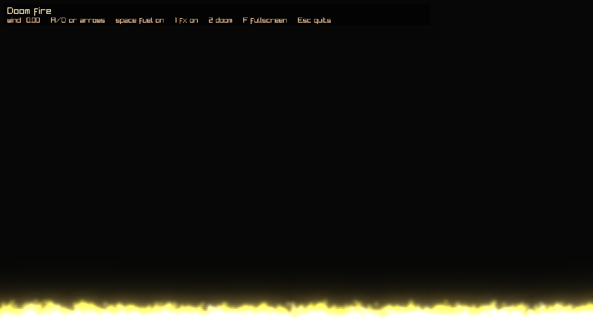

# Spike 0003 - DoomFire-Raylib port (M3 validation)

- Date: 2026-10-21
- Time spent: ~half a day
- Environment: .NET SDK 10.0.402, wasm-tools 10.0.13, Raylib-cs 8.1.0, Arch Linux, headless Chromium + SwiftShader

## Question

Can an existing desktop Raylib-cs game (DoomFire-Raylib) be ported onto Rayforge with mechanical changes only, and does the porting guide hold up?

## Setup

Source: `~/Work/DoomFire-Raylib` (Raylib-cs 8.0.0, embedded GLSL 330 shaders, blocking loop).

Port layout:

```text
games/DoomFire/
├── DoomFire.Game/          # FireSlice + simulation + presenter
├── DoomFire.Web/
├── DoomFire.Desktop/
└── Assets/shaders/{gl330,es100}/*.txt
```

## Results

- Desktop: shaders load from `assets/shaders/gl330/*.txt`, fire + HUD + resize run.
- Web (DevServer + headless Chromium): MEMFS preload of 8 shader files (~6 KB), ES 100 shaders compile, Fill mode canvas 1280x720, loop starts without a click gesture (no audio).
- Host-specific game changes: well under 50 lines (split `Main`, `RequestQuit` / `ToggleFullscreen`, `dt` instead of `GetFrameTime`, runtime shader folder). Thin hosts are ~20 lines of `Program.cs` each.
- Pointer lock: not needed; spike 0004 stays deferred to M6.
- Preload groups: not needed; Bundled is enough for tiny shaders.



## Failures / friction (folded into PORTING-GUIDE.md)

1. **Unknown MIME types 404 on DevServer.** `.frag` / `.vert` / `.glsl` are not in ASP.NET's content-type map; StaticFiles returns 404. Suffix `.txt` (`text/plain`).
2. **Raylib-cs 8.1.0 `browser-wasm` is WebGL 1 / GLSL ES 100**, not ES 300. `#version 300 es` fails with `unsupported shader version 300`. Confirmed by `#version 100` strings in the package `raylib.a`.
3. **GLSL ES 100 has no `textureSize()`.** Pass a `heatSize` uniform from C#.
4. **Dynamic indexing of uniform arrays is illegal in WebGL 1 fragment shaders.** Use a loop whose index is the array subscript.
5. **Embedded resources vs Assets.** Original game embedded shaders; Assets + MEMFS is the Rayforge path and caught the MIME / ES issues the embed path would have hidden until first draw.

## Decision

**Proceed.** M3 exit criteria met. Porting guide is no longer a draft. Next milestone is M4 (template + packages).

## Follow-ups

- Optional: MIME map for `.frag`/`.vert`/`.glsl` in the DevServer story (framework or host docs).
- Optional: if a future Raylib-cs `browser-wasm` build switches to WebGL 2, add `es300/` alongside `es100/` and pick by capability.
